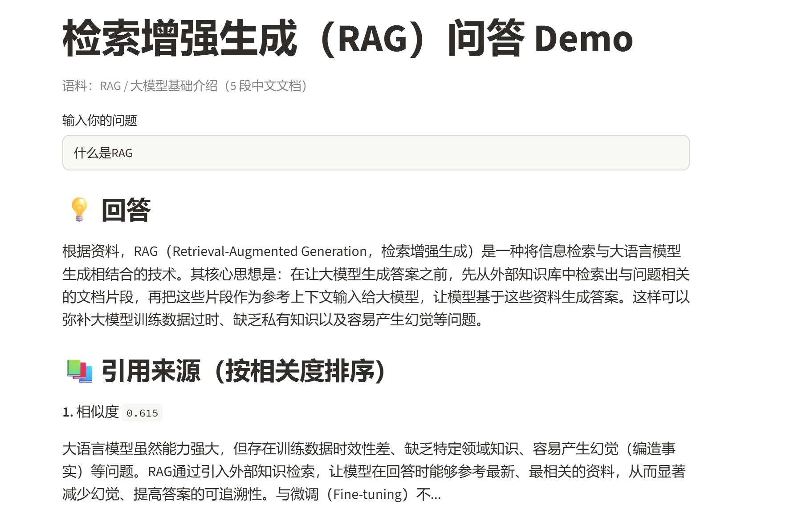
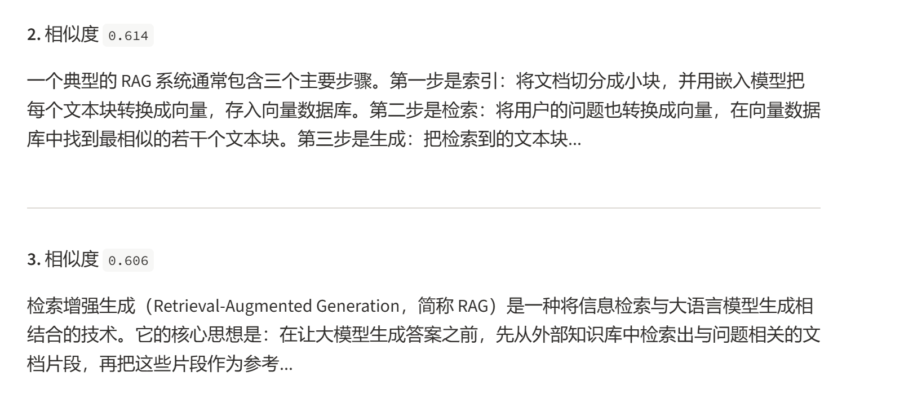
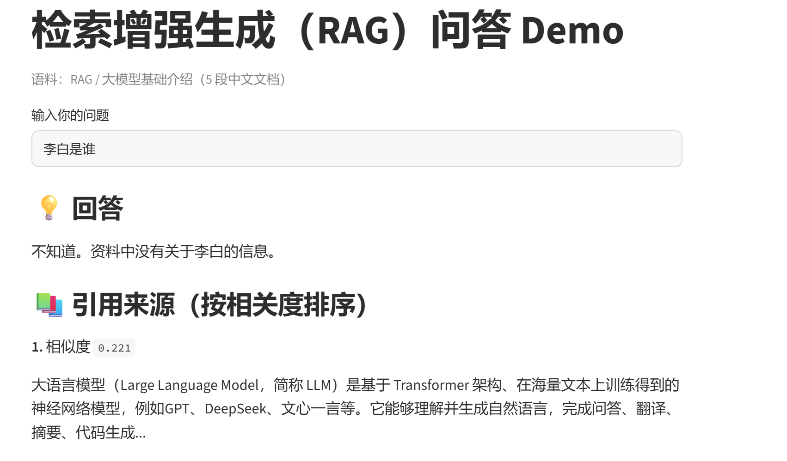
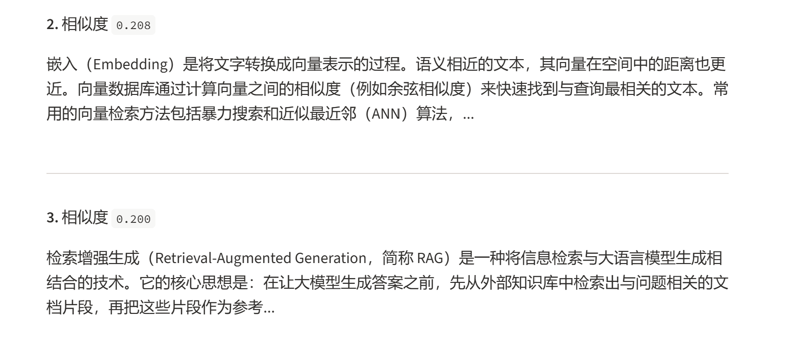

# RAG 问答系统 Demo

一个基于 **检索增强生成（Retrieval-Augmented Generation, RAG）** 的中文问答系统。

用户提问后，系统先从本地知识库中检索最相关的文档片段，再交给大语言模型**基于这些资料**生成答案，从而抑制大模型「幻觉」、提高答案的可追溯性。

## 功能特点

- 对本地中文语料做**语义检索**（而非关键词匹配），能理解「意思相近但用词不同」的提问
- 答案**附带引用来源与相似度**，可追溯「这句话出自哪段资料」
- 通过 Prompt 约束模型「只依据资料回答，资料没有就说不知道」，显著减少编造
- Streamlit 网页交互界面，输入问题即可问答

## 系统架构

```
语料文档 ──嵌入──▶ 向量 ──▶ FAISS 索引
用户问题 ──嵌入──▶ 查询向量 ──相似度检索──▶ top-3 片段
                                            │
                                  ┌─────────┘
                                  ▼
                        拼接 Prompt ──▶ DeepSeek ──▶ 答案 + 引用来源
```

## 技术栈

| 环节 | 方案 |
|---|---|
| 大语言模型 | DeepSeek（deepseek-chat） |
| 嵌入模型 | BAAI/bge-small-zh-v1.5（sentence-transformers） |
| 向量检索 | FAISS（IndexFlatIP，归一化内积 = 余弦相似度） |
| 界面 | Streamlit |

## 项目结构

```
rag-demo/
├── rag.py            # 核心：语料、嵌入、检索、生成
├── app.py            # Streamlit 网页界面
├── requirements.txt  # 依赖
└── README.md
```

## 快速开始

### 1. 安装依赖

```bash
python -m venv venv
source venv/Scripts/activate          # Windows Git Bash
pip install torch --index-url https://download.pytorch.org/whl/cpu
pip install openai sentence-transformers faiss-cpu numpy streamlit python-dotenv
```

### 2. 配置 DeepSeek API Key

在 `rag.py` 中设置（或写入环境变量 `DEEPSEEK_API_KEY`）：

```python
import os
from dotenv import load_dotenv

load_dotenv()
LLM = OpenAI(api_key=os.getenv("DEEPSEEK_API_KEY"), base_url="https://api.deepseek.com")
```

> 不要将真实 Key 提交到 GitHub。

### 3. 运行

```bash
streamlit run app.py
```

浏览器打开 `http://localhost:8501`，输入问题即可。

## 效果展示

**问题：什么是 RAG？**

> 
> 

**负面测试：李白的代表作有哪些？**

> 
> 

## 实现要点与发现

1. **嵌入模型与查询指令**：bge
系列模型要求查询时添加指令前缀（`为这个句子生成表示以用于检索相关文章：`），添加后相似度从约 0.47 提升到约 0.61。
2. **同质语料导致 top-1 不稳定**：当所有语料主题接近时，向量分数会「打平」，top-1 不一定是最优段落。因此 RAG 需要取**top-k** 交给 LLM 兜底，而非只看第一名——本项目中定义段落虽排第 3，LLM 仍能从中选出并答对。
3. **反幻觉 Prompt**：通过「请仅根据以下资料回答，资料里没有就说不知道」约束生成，使负面问题（语料外内容）得到诚实的「不知道」回答。

## 后续改进方向

- 引入**重排序模型（reranker）** 做二次排序，提升 top-1 准确率
- 支持多轮对话与引用高亮
- 接入更大规模语料，并实现按句子/段落的自适应切块

## GitHub链接

- https://github.com/qinyu-guo/rag-demo

---